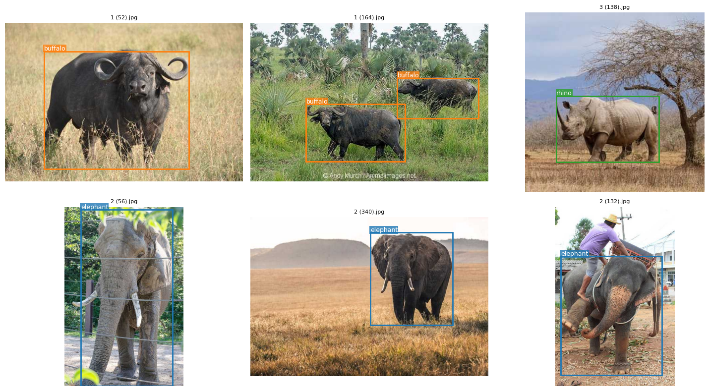
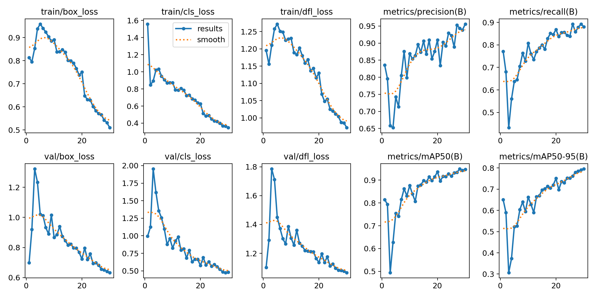
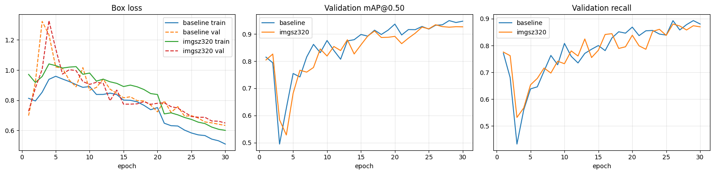
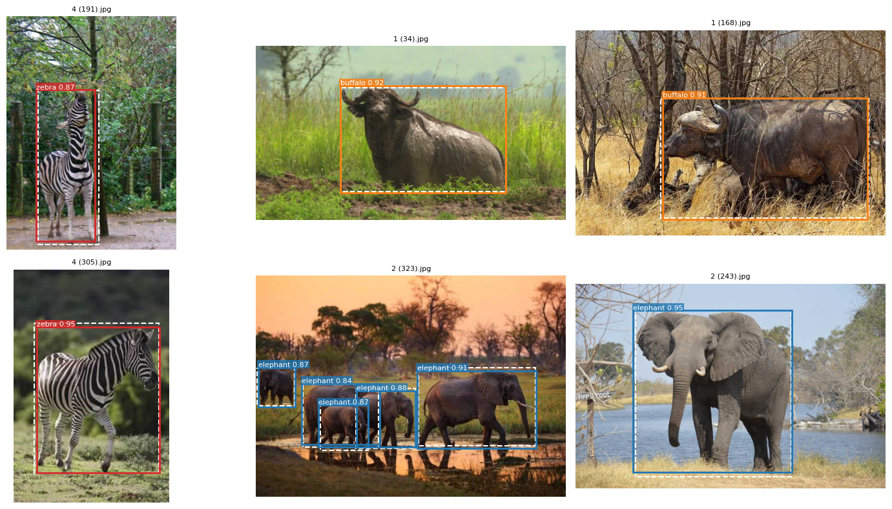
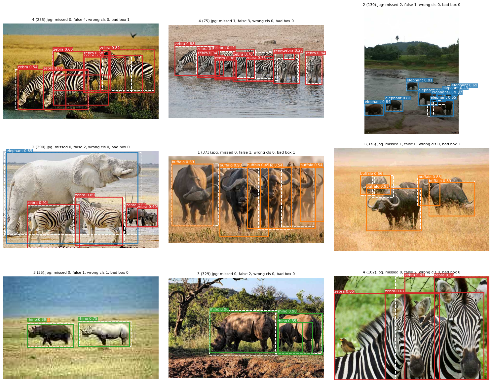

# Object Detection on the African Wildlife Dataset (YOLO11n)

**CSCI1409 Deep Learning, KBTU, Fall 2026 — Bonus Project**

[](https://colab.research.google.com/github/YOUR_USERNAME/african-wildlife-detection/blob/main/object_detection.ipynb)

## Task
Fine-tune a pretrained object detector to find and classify four African animals
(**buffalo, elephant, rhino, zebra**) in photos: for every animal the model outputs a bounding box,
a class name and a confidence score.

**Final result on the held-out test set:** precision **0.971**, recall **0.913**, mAP@0.50 **0.977**.

## Repository contents
| Path | What it is |
|---|---|
| `object_detection.ipynb` | Colab notebook: install → data → checks → training (2 runs) → comparison → test evaluation → predictions |
| `requirements.txt` | Dependency versions |
| `outputs/` | Figures and tables used in this README (dataset stats, label checks, learning curves, predictions, metrics, run configs `*_args.yaml`) |
| `runs/` | Raw Ultralytics outputs of both runs (training logs `results.csv`, curves, confusion matrices, PR curves); weights excluded |
| Release `v1.0` → `best.pt` | Final trained checkpoint (5.5 MB) |

## How to run
1. Click **Open in Colab** above.
2. **Runtime → Change runtime type → T4 GPU**.
3. **Runtime → Run all.** The notebook installs `ultralytics==8.4.216`, downloads the dataset (~100 MB),
   fixes the split, trains both models (~16 min on a T4), evaluates and draws predictions.
   At the end it downloads `best.pt` and `evidence.zip` (all outputs).

Only predictions with the trained model:
```python
!pip install -q ultralytics==8.4.216
!wget -q https://github.com/YOUR_USERNAME/african-wildlife-detection/releases/download/v1.0/best.pt
from ultralytics import YOLO
model = YOLO("best.pt")
model.predict("https://ultralytics.com/assets/african-wildlife-sample.jpg", conf=0.25, save=True)
```

Environment used: Google Colab, Tesla T4, Python 3.13.16, PyTorch 2.14.1+cu130, Ultralytics 8.4.216.

## 1. Dataset
- **Source:** [African Wildlife dataset](https://docs.ultralytics.com/datasets/detect/african-wildlife/),
  Ultralytics YOLO adaptation of the Kaggle dataset by Bianca Ferreira. Downloaded automatically by
  Ultralytics (`african-wildlife.yaml`).
- **Usage terms:** the original Kaggle dataset does not specify a license; Ultralytics distributes the
  adaptation for research/education. It is used here only for a non-commercial course project.
- **Classes:** 0 buffalo, 1 elephant, 2 rhino, 3 zebra.
- **Annotation format:** YOLO — one `.txt` file per image, one line per object:
  `class x_center y_center width height`, all normalized to 0–1 by the image size.

### Images and objects per split
Original split from the dataset authors:

| split | images | objects |
|---|---|---|
| train | 1052 | 1931 |
| val | 225 | 379 |
| test | 227 | 375 |
| **total** | **1504** | **2685** |

Split used in this project (after removing leakage, see below):

| split | images | objects | buffalo | elephant | rhino | zebra |
|---|---|---|---|---|---|---|
| train | 1083 | 1981 | 416 | 565 | 413 | 587 |
| val | 215 | 363 | 86 | 87 | 79 | 111 |
| test | 206 | 341 | 52 | 96 | 67 | 126 |
| **total** | **1504** | **2685** | **554** | **748** | **559** | **824** |

### Ground-truth examples


### Label quality check
- **Automatic check** of all 2685 boxes for missing/empty label files, malformed lines, invalid class IDs,
  boxes outside the image and tiny boxes (< 0.05 % of the image): **0 problems found**
  (`outputs/label_check.csv`).
- **Visual check** of 12 random images (`outputs/visual_check.png`): boxes and classes look correct, but some
  partly visible animals are **not labelled** (e.g. a buffalo in the background of `1 (348).jpg`, the edge of a
  second zebra in `4 (279).jpg`). Missing labels on partly visible animals also appear on the test set and
  explain part of the "false detections" in section 4.

### Duplicates and leakage — split fixed
Duplicate check across splits with MD5 (exact copies) and a 64-bit perceptual hash (dHash, near-duplicates
if ≤ 5 bits differ) found **20 exact duplicates and 33 near-duplicate pairs** between train, val and test
(`outputs/near_duplicates_original.csv`, examples in `outputs/near_duplicates.png`). This would leak training
images into evaluation and inflate the metrics.

**Fix (section 1.5 of the notebook):** all images were grouped by MD5 match or dHash distance ≤ 5
(union-find over the whole dataset); every group that spanned more than one split was moved
**entirely to train**. 31 images were moved (val 225 → 215, test 227 → 206); the list is in
`outputs/split_changes.csv`. The procedure is deterministic, so no random seed is involved.
After the fix: **0 exact and 0 near-duplicates across splits.**

## 2. Baseline training
| Setting | Value |
|---|---|
| Framework | Ultralytics 8.4.216 (PyTorch 2.14.1) |
| Model / initial weights | YOLO11n, `yolo11n.pt` (COCO-pretrained), 2.6 M parameters |
| Image size | 640 |
| Batch size | 16 |
| Epochs | 30 (no early stopping) |
| Optimizer / learning rate | SGD, lr0 = 0.01, momentum 0.937 (other settings: Ultralytics defaults, incl. default augmentation) |
| Random seed | 42, `deterministic=True` |
| Hardware / training time | Tesla T4, **9.6 min** |

The best checkpoint (`best.pt`) is selected automatically as the epoch with the best validation fitness
(Ultralytics fitness, dominated by mAP@0.50:0.95). Full config: `outputs/baseline_args.yaml`; training log:
`outputs/baseline_results.csv`.



## 3. Controlled experiment: image size
**Changed setting:** `imgsz` 640 → **320**. Same split, same initial weights `yolo11n.pt`, same epochs,
batch, optimizer, learning rate and seed.

**Hypothesis (stated before training):** 320-px images contain 4× fewer pixels, so training will be
noticeably faster, but precision, recall and mAP@0.50 on the validation set will be somewhat lower,
because small and distant animals lose detail.

**Results on the validation set** (each model at its own training size):

| Run | Changed setting | Precision | Recall | mAP@0.50 | mAP@0.50:0.95 | Training time |
|---|---|---|---|---|---|---|
| baseline | imgsz = 640 | **0.958** | **0.879** | **0.948** | **0.796** | 9.6 min |
| imgsz320 | imgsz = 320 | 0.919 | 0.872 | 0.927 | 0.768 | **5.7 min** |



**Explanation.** The hypothesis is confirmed. Training at 320 px was about 40 % faster, but every metric
dropped: mAP@0.50 by 0.021 and precision by 0.039. Most animals in this dataset are large, so even at
320 px the model finds almost all of them (recall only −0.007); the loss of detail mostly shows up as
less precise boxes and more false or confused detections. The stricter mAP@0.50:0.95, which rewards
accurate box borders, dropped more (−0.028) than mAP@0.50. The largest per-class drop was for rhino
precision (0.961 → 0.879). For this task the extra 4 minutes of training at 640 px are worth it, so the
**baseline (640) is selected as the final model** — based on validation results only.

## 4. Final evaluation on the test set
The checkpoint selected on validation (baseline `best.pt`) was evaluated **once** on the test set.

| Precision | Recall | mAP@0.50 | mAP@0.50:0.95 |
|---|---|---|---|
| **0.971** | **0.913** | **0.977** | **0.828** |

Per class mAP@0.50: buffalo 0.978, elephant 0.974, rhino 0.988, zebra 0.970.

**Evaluation settings:** Ultralytics `val`, image size 640, confidence threshold **0.001**,
NMS IoU **0.7**; a prediction is a true positive if its IoU with a ground-truth box of the same class
is **≥ 0.50**. Prediction images and the error analysis use confidence **0.25**.

**What the metrics mean**
- **IoU** (Intersection over Union): overlap of two boxes divided by their combined area (1 = identical boxes).
- **Precision:** of all boxes the model predicted, the share that are correct — "how many detections are real".
- **Recall:** of all real animals, the share the model found — "how many animals were not missed".
  (Ultralytics reports P and R at the confidence that gives the best F1 score.)
- **mAP@0.50:** for each class, the area under the precision–recall curve (Average Precision) with
  IoU ≥ 0.50 counted as a match, averaged over the 4 classes. It summarizes precision and recall
  over all confidence thresholds. mAP@0.50:0.95 averages this over stricter IoU thresholds 0.50–0.95.

### Predictions on test images
Solid boxes = predictions (class and confidence), dashed white boxes = ground truth.


### Failure analysis
At conf 0.25, over 341 test objects: 11 missed animals, 42 false detections, 3 wrong classes,
6 inaccurate boxes; 42 of 206 images contain at least one error (`outputs/test_errors_per_image.csv`).



1. **Crowded, overlapping animals — `4 (75).jpg`** (8 zebras; 1 missed, 3 false detections).
   A herd of zebras stands side by side in the water and the animals overlap. The stripe patterns of
   neighbouring zebras merge, so the model places extra low-confidence boxes (0.27–0.41) over parts of two
   zebras and misses one that is almost fully hidden. *Likely cause:* heavy occlusion; NMS keeps or removes
   overlapping boxes incorrectly when real animals overlap a lot. The same pattern appears in `4 (235).jpg`.
2. **Small, distant animals — `2 (130).jpg`** (10 elephants; 2 missed, 1 false detection).
   The elephants are far away in a river and only a few pixels tall, partly hidden by rocks and each other.
   *Likely cause:* after resizing to 640 px the smallest elephants have too little detail; small objects
   are rare in the training set.
3. **Wrong class on a low-quality image — `3 (55).jpg`** (2 rhinos; 1 wrong class, 1 false detection).
   The photo is small and pixelated. The dark rhino gets a low confidence (0.39) and an extra box with a
   different class; without the horn visible in detail its dark silhouette resembles a buffalo.
   *Likely cause:* low resolution and similar body shape/colour of rhino and buffalo.

Several "false detections" (e.g. in `2 (290).jpg` and `4 (235).jpg`) are actually real, partly visible
animals that are **missing from the ground truth**, so the true precision is slightly higher than measured.

**Practical next step:** train and predict at a larger image size (e.g. `imgsz=960`) or use tiled
inference (SAHI) for small, distant animals, and re-label crowded images so that every partly visible
animal has a box (this also fixes the misleading false-positive counts).

## Limitations
- Small dataset (1504 images, 4 classes) of mostly large, centred animals; performance on camera-trap or
  drone images with small animals would likely be much lower.
- Some ground-truth boxes are missing for partly visible animals, which affects both training and metrics.
- Only one run per setting (seed 42); small metric differences (±0.01) may be within run-to-run noise.
- The test set is small (206 images), so per-class metrics have high uncertainty.
- 30 epochs only; the validation curves are still slowly rising, so longer training might help.

## Credits
- [Ultralytics YOLO](https://github.com/ultralytics/ultralytics) (AGPL-3.0): framework, YOLO11n pretrained weights,
  training and evaluation code.
- African Wildlife dataset: Bianca Ferreira (Kaggle), adapted by Ultralytics.
- **My additions:** label-quality checks, duplicate/near-duplicate detection and the leakage-free split,
  the controlled image-size experiment, the per-image error analysis and the failure-case discussion,
  and this documentation.
